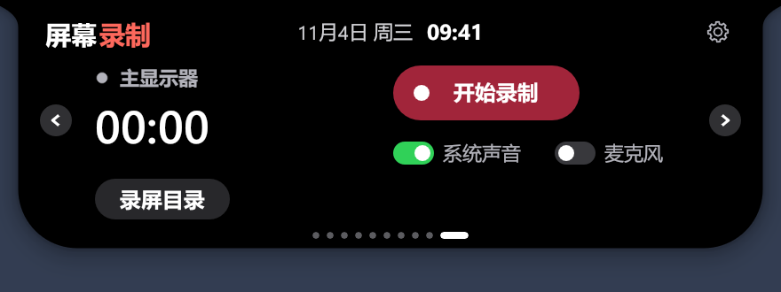
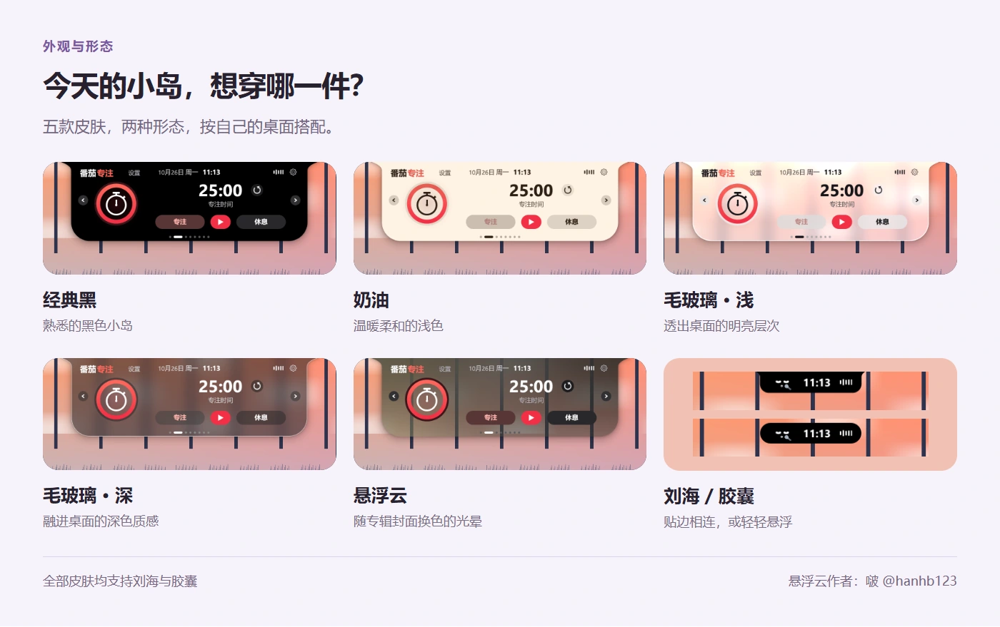

<div align="center">


# 岛仔 · Daozai

迟迟（chichi）维护和发布的 Windows 桌面信息岛。鼠标靠近屏幕边缘，即可录屏、控制音乐、查看日程或取回刚复制的内容。

[](https://github.com/dh666i/daozai/releases/latest)
[](https://github.com/dh666i/daozai/actions/workflows/ci.yml)
[](LICENSE)

**[下载 Windows x64 版](https://github.com/dh666i/daozai/releases/latest)** · [使用指南](docs/USAGE.md) · [更新记录](CHANGELOG.md) · [问题反馈](https://github.com/dh666i/daozai/issues)

</div>

## 安装和更新

支持 Windows 10 和 Windows 11 x64。迟迟的首个独立发行版为 **v1.0.0**。首次安装或从其他发行渠道切换时，请前往[正式版下载页](https://github.com/dh666i/daozai/releases/latest)。

| 下载文件 | 用法 |
| --- | --- |
| `Daozai-Setup-v版本号-x64.exe` | 双击安装。可选安装位置、桌面快捷方式和开机自启。 |
| `Daozai-v版本号-windows-x64.zip` | 完整解压后运行 `daozai.exe`，保留同目录下的 `recorder` 文件夹。 |
| `SHA256SUMS.txt` | 用 PowerShell 的 `Get-FileHash -Algorithm SHA256` 计算下载文件的哈希，和同名条目核对。 |

日常更新从「设置 → 关于 → 检查更新」进入。程序查询本仓库最新正式版并校验安装包的 SHA-256。安装版和免安装版都使用 `%APPDATA%\Daozai` 保存用户数据。

## 屏幕录制

打开独立的「录屏」页，或右键系统托盘里的岛仔图标选择「录屏」，即可录制主显示器。系统声音默认开启，麦克风默认关闭，可在录屏页或「设置 → 录屏」中分别调整。

录制时可暂停、继续，最后点击「停止并保存」生成 MP4。点击「录屏目录」可直接打开 Windows 视频文件夹下的「岛仔录屏」。



## 桌面功能

「外设电量」显示设备的电量、连接方式和充电状态。开启「岛上电量」，收起的小岛会用设备图标和电量环指示状态，展开后可看具体百分比。支持 ROG 月刃 2 RGB、Falchion RX Low Profile 的 Omni 接收器和 USB 连接，也支持上报电池信息的蓝牙鼠标、键盘及耳机。

| 功能 | 在岛上可以做什么 |
| --- | --- |
| 截图和剪贴板 | 在「置物架 → 截图」框选屏幕，复制图片、识别文字或读取二维码。剪贴板保留最近 30 条未固定的图文，常用内容可以固定。文字识别使用本机 Windows OCR 语言包。 |
| 文件置物架 | 拖入文件临时收集，点开文件、定位到所在目录，或拖到其他应用。 |
| 音乐与歌词 | 控制播放、切歌、音量和进度。播放器提供媒体信息时，可查看封面和匹配到的同步歌词。 |
| 通知与邮件 | 接收微信、QQ 等通知，通过 IMAP 阅读来信、复制验证码和查看日历邀请。 |
| 日程与提醒 | 查看月历、导入 ICS、连接工作日历，设置待办、番茄专注、饮水和久坐提醒。 |
| 天气与 AI 额度 | 查看天气实况和七日预报。连接支持的工具后，可查看订阅额度、重置时间、积分或余额。 |
| 外观与停靠 | 选择皮肤与吉祥物表情，让岛体停靠在顶部、左侧或右侧。可调整常驻内容、页面顺序和全屏避让。 |



邮箱、日历、天气和 AI 额度按需连接。各项服务的账号要求、数据目录和疑难解答见[使用指南](docs/USAGE.md)与[隐私说明](docs/PRIVACY.md)。

## 从源码运行

在 Windows 上安装 Rust stable、Visual Studio C++ 构建工具和 Windows SDK，然后在仓库根目录运行以下命令。第二条命令为录屏准备 Windows 助手及运行库。

```powershell
cargo build --locked --release --bin daozai
.\scripts\prepare-recorder.ps1 -OutputDirectory .\target\release\recorder
.\target\release\daozai.exe
```

测试、项目结构和本地开发环境见[开发指南](CONTRIBUTING.md)。发布脚本使用 NSIS 3 构建安装包。

## 开源与致谢

迟迟（chichi）负责本发行版的开发、维护和发布。项目沿用小唐的Token 与 Daozai 贡献者的岛仔 v0.6.66 源码，按 MIT 许可分发。[原项目](https://github.com/Renly1994/xiaotang-daozai/tree/v0.6.66) · [MIT 许可证](LICENSE)

「悬浮云」皮肤由啵创作。桌面界面使用 Rust 和 egui，Windows 录屏使用 ScreenRecorderLib，二维码识别使用 rqrr。随附组件和素材的版权与许可证见[第三方声明](THIRD_PARTY_NOTICES.txt)和[依赖说明](docs/DEPENDENCIES.md)。[皮肤作者](https://github.com/hanhb123)
